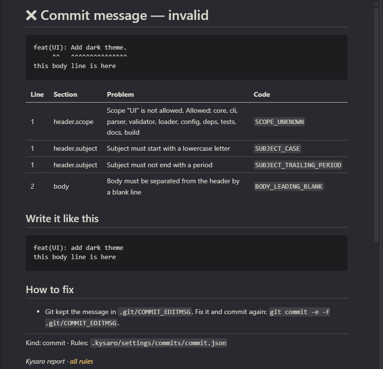

# Kysaro

A strict commit message linter for teams using Conventional Commits. Rules live in JSON files with JSON Schemas for IDE completion and validation.

[](https://www.npmjs.com/package/kysaro)
[](https://github.com/murpiano/kysaro/actions/workflows/ci.yml)
[](https://github.com/murpiano/kysaro/releases/latest)

[How it works](#how-it-works) · [Run locally](#run-locally) · [CLI](#cli)

## What you can do

Check a commit message before Git records it, validate a range of commits, and check pull request titles and descriptions in GitHub Actions. Configure types, scopes, subject case, body length, footers, and breaking changes without plugins. Invalid messages produce a report with the affected lines and a suggested header. Use the Node.js API when you need to run the same checks in another tool.

```text
$ git commit -m "feat(UI): Add dark theme."
[kysaro] ✖ Commit message is invalid

  feat(UI): Add dark theme.

  ✖ Scope "UI" must be in lower case  header.scope
  ✖ Subject must start with a lowercase letter  header.subject
  ✖ Subject must not end with a period  header.subject

  Suggested header: feat(ui): add dark theme
```

## How it works

### Local hooks and CI

Install Kysaro in the project you want to check:

```sh
npm install --save-dev kysaro
npx kysaro init
```

The initializer copies rules to `.kysaro/settings`, creates `.github/workflows/kysaro.yml`, and ignores generated `.kysaro/*.md` reports. It installs `commit-msg` in `.husky` when Husky is present, otherwise in `.git/hooks`. Existing files are preserved unless you pass `--force`; review those files before overwriting them. Commit the settings and workflow so the team shares the rules. Git's local hooks are not distributed by a clone, so use Husky when the team needs a shared hook.

| Context | Checked content | Rules |
| --- | --- | --- |
| Local commit | Commit message | `commit.json` |
| Local merge | Merge commit message | `merge.json` |
| CI push | Pushed commits, including merges | `commit.json`, `merge.json` |
| CI pull request | Title, description, and commits | `request.json`, `commit.json`, `merge.json` |

Each CLI check writes `.kysaro/report.md`. In GitHub Actions the report also appears in the job summary. Use a full clone (`fetch-depth: 0`) for commit range checks. The generated workflow runs on pushes and pull request events, including title and description edits.

### Message rules

The default header is `type(scope): subject`, up to 72 characters. Scope is optional; types and scopes use lowercase. The subject has at least five characters, starts lowercase, and has no trailing period. Names such as `API` and `GitHub` keep their spelling. Separate the body and footer from the preceding section with a blank line; commit body and footer lines are limited to 72 characters.

```text
feat(cli): add a range check

Check all commits before opening a pull request.

Refs: #42
```

Pull request and merge bodies are required and must contain at least 50 characters. Pull request headers allow 72 characters; merge headers allow 80. The default Git message `Merge branch 'feature'` fails these rules: write a Conventional Commit message for the merge.

### Configuration

Settings are loaded from `.kysaro/settings` in the project root. Missing files use package defaults. Invalid settings also fall back to defaults, with a warning and diagnostic reports in `.kysaro/main.md` or `.kysaro/commits.md`.

| File under `.kysaro/settings` | Purpose |
| --- | --- |
| `main/main.json` | Pipeline stages, severity, ignored messages |
| `commits/commit.json` | Commit rules |
| `commits/merge.json` | Merge rules |
| `commits/request.json` | Pull request title and description rules |
| `resources/types.json` | Allowed types |
| `resources/scopes.json` | Allowed scopes |
| `resources/tokens.json` | Allowed footer tokens |

Each file links its JSON Schema through `$schema`. Resource paths in `fromFiles` are relative to the settings file that declares them; those files must exist. For example, require a scope from your resource file in `commits/commit.json`:

```json
"scope": {
  "required": true,
  "source": { "fromFiles": ["../resources/scopes.json"] },
  "case": "lower",
  "onMultiple": "error"
}
```

See [docs/SPEC.md](docs/SPEC.md) for the full configuration reference in Russian, including issue codes, conditional requirements, case rules, and resource sources.

### Node.js API

```js
const {lint, createLinter, COMMIT_TYPE} = require('kysaro');

const result = lint('feat(cli): add range checks', {cwd: process.cwd()});
console.log(result.status); // 'valid', 'invalid', or 'ignored'
console.log(result.issues);

const check = createLinter(); // Load settings once.
check('feat: add range checks', COMMIT_TYPE.COMMIT);
```

`parseMessage(message)` returns the message AST without validation. TypeScript declarations are included.

## Run locally

Needs Node.js 20 or later and Git.

```sh
git clone https://github.com/murpiano/kysaro.git
cd kysaro
npm ci

npm test
npm run test:coverage
npm start
```

`npm ci` installs the repository's Husky hooks. The pre-commit hook runs tests; `commit-msg` checks messages with the local Kysaro source. `npm start` runs the pipeline on a sample message.

Tests live beside the source in `__tests__` directories. [CI](.github/workflows/ci.yml) runs tests on Node.js 20, 22, and 24, checks package contents, and validates commit and pull request messages.

After successful CI on a push to `main`, [Release](.github/workflows/release.yml) creates a release when `RELEASES=on`. `feat` increments minor, `fix` and `perf` increment patch, and breaking changes increment major. Other commit types do not trigger a release. Notes use the committed [release template](.github/release-notes.md); see [CHANGELOG.md](CHANGELOG.md) and [GitHub Releases](https://github.com/murpiano/kysaro/releases) for changes.

```sh
bash .github/scripts/release.sh --dry-run
```

Automatic releases require `RELEASE_TOKEN`. Publishing a GitHub Release starts [npm publication](.github/workflows/publish.yml), which verifies CI for the tagged commit, sets the package version in the runner, and publishes with `NPM_TOKEN`. It does not create a version commit.

## Where things live

```text
bin/                 CLI entry point
src/cli/             Initialization, CI and range commands
src/lib/             Parsing, loading, validation and reports
src/settings/        Default rules, resources and JSON Schemas
.kysaro/settings/    This repository's own message rules
docs/SPEC.md         Configuration reference
```

Tests are colocated with their modules. Repository-specific rules stay separate from the defaults distributed in the package.

## CLI

```text
kysaro <file>              Check a commit message file
kysaro -m <message>        Check a message
kysaro < message.txt       Check a message from stdin
kysaro --range <a>..<b>    Check every commit in a range
kysaro ci                  Check GitHub Actions commits and pull requests
kysaro init                Set up the hook, settings and workflow

Options:
  -m, --message <text>     Message to check
      --type <kind>       commit, merge, or request
      --force             Overwrite existing init files
  -h, --help              Show help
  -v, --version           Show version
```

Exit codes: `0` for valid or ignored messages, `1` for invalid messages, `2` for argument or settings errors. A valid message prints nothing; warnings do not block the commit. Git comments, verbose diffs, and extra whitespace are cleaned before validation; the message file remains unchanged.

## Rough edges

- `fixer`, `analyzer`, and `generator` settings exist, but those stages are not connected yet.
- `fixup!`, `squash!`, and `amend!` messages are allowed locally but fail CI until squashed. Revert messages are skipped.
- GitHub's merge button does not run local hooks. Require the `kysaro` status check in branch protection and configure merge or squash messages to use the checked pull request title and description.

---

<sub>[Bogdan Trotsenko](https://github.com/murpiano) · [murpiano](https://github.com/murpiano) · [Telegram](https://t.me/murpiano) · [MIT](LICENSE)</sub>
